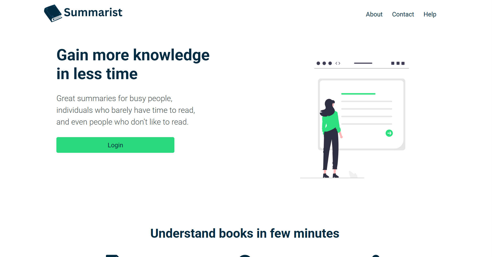

</> Markdown
## Summarist Book Summary Platform Screenshot



## 🛠️ Tech Stack

* React — User interface development.
* JavaScript (ES6+) — Interactive functionality.
* TypeScript — Static type checking to JavaScript.
* Next.js — React framework for building web applications.
* REST API — Communication with web services through REST endpoints

### 🚀 Key Features

*  📚 Discover Popular Books: Explore a curated collection of trending books across multiple genres to find your next favorite read.
*  ⚡ Concise Book Summaries: Access easy-to-read summaries that highlight key ideas, main concepts, and valuable insights in less time.
*  🎯 Personalized Recommendations: Discover books tailored to your interests through an intuitive, user-friendly interface designed to make finding your next read effortless.


## Summarist Book Summary Platform

🔗 **Live Demo:** [View Live Website](https://advanced-virtual-internship-purpleg.vercel.app/foryou)

A React platform that helps readers discover popular books

## Summarist Book Summary Platform

A web application built with Next.js, React, and TypeScript. The project uses the Next.js App Router, Firebase Authentication with Google sign-in, Redux Toolkit for state management, and Tailwind CSS for styling.

Tech Stack
Framework: Next.js 16.2.6
Frontend: React 19.2.4
Language: TypeScript
Styling: Tailwind CSS 4
Authentication: Firebase Authentication and Google sign-in
State Management: Redux Toolkit and React Redux
Icons: React Icons
Code Quality: ESLint
Prerequisites

Before installing the project, ensure you have the following tools installed.

1. Node.js and npm

Install a Node.js version compatible with Next.js 16.

Download: https://nodejs.org/

Verify your installation:

node -v
npm -v
2. Git

Git is recommended for cloning the repository.

Download: https://git-scm.com/downloads

Verify the installation:

git --version
3. Visual Studio Code

Visual Studio Code is recommended for editing and managing the project.

Download: https://code.visualstudio.com/

Installation and Local Setup

Follow these steps to run the application on your local machine.

Step 1: Clone the Repository

Clone the project from GitHub:

git clone YOUR_GITHUB_REPOSITORY_URL

Replace YOUR_GITHUB_REPOSITORY_URL with the actual URL of your repository.

Navigate into the project directory:

cd julius-advanced-virtual-internship

If you have already downloaded the project, open its root directory in Visual Studio Code instead.

Step 2: Install Dependencies

Ensure you are in the directory containing package.json and package-lock.json.

Run:

npm ci

This installs the dependencies recorded in the project's lockfile.

If npm ci fails because the lockfile is missing or inconsistent with package.json, run:

npm install
Step 3: Configure Firebase Authentication

The application includes a firebaseConfig.js file that initializes Firebase and exports authentication functionality for Google sign-in.

To configure Firebase for your own project:

Open the Firebase Console.
Create a Firebase project or select an existing project.
Register a web application in the project settings.
Copy the Firebase web configuration values.
Update the configuration used by your application.
Open Authentication → Sign-in method in the Firebase Console.
Enable the Google sign-in provider.
Configure the authorized domains for your application.

The current configuration initializes Firebase using these fields:

apiKey
authDomain
projectId
storageBucket
messagingSenderId
appId

Important: The Firebase configuration currently contains hardcoded values. If you intend to use your own Firebase project, replace them with your project's actual configuration.

Firebase web configuration values are not equivalent to private server credentials. However, you should protect your project with appropriate Firebase Authentication, authorized-domain, and security-rule settings.

Step 4: Start the Development Server

Run:

npm run dev

Wait for Next.js to finish starting.

Open your browser and visit:

http://localhost:3000

You should now be able to access the application locally.

If port 3000 is unavailable, Next.js may select another port. Use the URL displayed in your terminal.

Environment Variables

The provided firebaseConfig.js currently defines its configuration directly in the source code. Therefore, a .env.local file is not strictly required for the Firebase initialization as it is currently written.

However, if you want to manage the Firebase configuration through environment variables, you can update the file as follows.

Example .env.local

Create a .env.local file in the project root:

NEXT_PUBLIC_FIREBASE_API_KEY=your_firebase_api_key
NEXT_PUBLIC_FIREBASE_AUTH_DOMAIN=your_project.firebaseapp.com
NEXT_PUBLIC_FIREBASE_PROJECT_ID=your_project_id
NEXT_PUBLIC_FIREBASE_STORAGE_BUCKET=your_project.firebasestorage.app
NEXT_PUBLIC_FIREBASE_MESSAGING_SENDER_ID=your_messaging_sender_id
NEXT_PUBLIC_FIREBASE_APP_ID=your_firebase_app_id

Replace the example values with those provided by your Firebase project.

Update firebaseConfig.js

If you choose to use environment variables, update the Firebase configuration to read them:

import { initializeApp, getApps, getApp } from "firebase/app";
import {
  getAuth,
  GoogleAuthProvider,
  signInWithPopup,
} from "firebase/auth";

const firebaseConfig = {
  apiKey: process.env.NEXT_PUBLIC_FIREBASE_API_KEY,
  authDomain: process.env.NEXT_PUBLIC_FIREBASE_AUTH_DOMAIN,
  projectId: process.env.NEXT_PUBLIC_FIREBASE_PROJECT_ID,
  storageBucket: process.env.NEXT_PUBLIC_FIREBASE_STORAGE_BUCKET,
  messagingSenderId: process.env.NEXT_PUBLIC_FIREBASE_MESSAGING_SENDER_ID,
  appId: process.env.NEXT_PUBLIC_FIREBASE_APP_ID,
};

const app = getApps().length ? getApp() : initializeApp(firebaseConfig);

export const auth = getAuth(app);

const provider = new GoogleAuthProvider();

export const signInWithGoogle = () => {
  return signInWithPopup(auth, provider);
};

export default app;

Note: This is an optional configuration change. Your existing file can continue using hardcoded Firebase web configuration values if you prefer.

Variables prefixed with NEXT_PUBLIC_ are exposed to browser-side code. Never store private API secrets, service account keys, or other confidential server credentials in these variables.

After modifying .env.local, restart the development server.

Running the Project
Development Mode

Use development mode while developing and debugging the application.

npm run dev

Open:

http://localhost:3000

To stop the server, press Ctrl + C in the terminal.

Production Build

To prepare the application for production, run:

npm run build

This command compiles the application and reports build-time errors.

Fix any reported errors before proceeding.

Start the Production Server

After a successful production build, run:

npm run start

Open:

http://localhost:3000

Important: Run npm run build again after making changes that need to be included in the production version.

Run ESLint

The project defines a lint script in package.json.

Run:

npm run lint

This checks the code using ESLint and the project's configured rules.

Project Structure

The application uses the Next.js App Router.

app/
├── (app)/
│   └── player/
│       └── [id]/
│           └── page.tsx
├── book/
│   └── [id]/
│       └── page.tsx
├── components/
│   ├── GoogleIcon.tsx
│   └── LoginIcon.tsx
├── foryou/
│   └── page.tsx
├── library/
│   └── page.tsx
├── settings/
│   └── page.tsx
├── AuthModal.tsx
├── Footer.tsx
├── Hero.tsx
├── Homesections.tsx
├── LoginForm.tsx
├── Navbar.tsx
├── Navbarsection.tsx
├── RegisterForm.tsx
├── ReviewsButton.tsx
├── Statistics.tsx
├── Statistics2.tsx
├── globals.css
├── layout.tsx
└── page.tsx

public/
├── file.svg
├── globe.svg
├── landing.e4787d01.png
├── next.svg
├── vercel.svg
└── window.svg

firebaseConfig.js
next.config.ts
package.json
package-lock.json
postcss.config.mjs
eslint.config.mjs
tsconfig.json
README.md
Key Directories and Files
File or Directory	Description
app/	Contains application pages, layouts, and components.
app/page.tsx	Defines the root application page.
app/layout.tsx	Defines the shared application layout.
app/components/	Contains reusable UI components.
app/LoginForm.tsx	Contains the login form.
app/RegisterForm.tsx	Contains the registration form.
app/AuthModal.tsx	Contains the authentication modal.
app/globals.css	Defines global CSS styles.
public/	Contains static assets.
firebaseConfig.js	Initializes Firebase and configures authentication.
package.json	Defines project dependencies and npm scripts.
package-lock.json	Records the dependency versions used by npm.
next.config.ts	Contains Next.js configuration.
tsconfig.json	Contains TypeScript compiler settings.
eslint.config.mjs	Contains ESLint configuration.
Troubleshooting
Node.js or npm Is Not Recognized

Cause: Node.js may not be installed correctly or may be missing from your system's PATH.

Solution:

Install Node.js from https://nodejs.org/.
Restart your terminal.
Run:
node -v
npm -v
Dependency Installation Fails

Try installing the dependencies again:

npm install

If the error persists, check the Node.js version and review the installation error for the affected package.

Development Server Does Not Start

Verify that you are in the project root and that the required dependencies are installed.

Run:

npm run

Confirm that the dev script is available.

Then run:

npm run dev

Check the terminal output for compilation errors.

Google Sign-In Does Not Work

Check the following:

Google sign-in is enabled in the Firebase Authentication settings.
The Firebase configuration matches the intended project.
The application's current domain is authorized in Firebase Authentication.
The browser console does not report a Firebase authentication error.
The Google sign-in action is triggered by a supported user interaction.

For local development, verify that localhost is permitted where required.

Firebase Configuration Errors

If Firebase cannot initialize correctly:

Verify the Firebase configuration values.
Ensure the environment variable names match those referenced in the source code.
Confirm that .env.local is located in the project root if you are using environment variables.
Restart the development server after changing configuration values.
Port 3000 Is Already in Use

Start the development server on another port:

npm run dev -- --port 3001

Open:

http://localhost:3001

For production, run:

npm run start -- --port 3001
Production Build Fails

Run:

npm run build

Review the reported error and resolve it before trying again.

Check for TypeScript errors, incorrect imports, missing dependencies, and configuration issues.

Linting Errors

Run:

npm run lint

Review the reported file paths and line numbers, then fix the identified issues.

Quick Start

For developers who already have Node.js installed and have cloned the repository:

# Install dependencies
npm ci

# Start the development server
npm run dev

Open http://localhost:3000 in your browser.

To build and start the production version:

# Build the application
npm run build

# Start the production server
npm run start

This is a [Next.js](https://nextjs.org) project bootstrapped with [`create-next-app`](https://nextjs.org/docs/app/api-reference/cli/create-next-app).

## Getting Started

First, run the development server:

```bash
npm run dev
# or
yarn dev
# or
pnpm dev
# or
bun dev
```

Open [http://localhost:3000](http://localhost:3000) with your browser to see the result.

You can start editing the page by modifying `app/page.tsx`. The page auto-updates as you edit the file.

This project uses [`next/font`](https://nextjs.org/docs/app/building-your-application/optimizing/fonts) to automatically optimize and load [Geist](https://vercel.com/font), a new font family for Vercel.

## Learn More

To learn more about Next.js, take a look at the following resources:

- [Next.js Documentation](https://nextjs.org/docs) - learn about Next.js features and API.
- [Learn Next.js](https://nextjs.org/learn) - an interactive Next.js tutorial.

You can check out [the Next.js GitHub repository](https://github.com/vercel/next.js) - your feedback and contributions are welcome!

## Deploy on Vercel

The easiest way to deploy your Next.js app is to use the [Vercel Platform](https://vercel.com/new?utm_medium=default-template&filter=next.js&utm_source=create-next-app&utm_campaign=create-next-app-readme) from the creators of Next.js.

Check out our [Next.js deployment documentation](https://nextjs.org/docs/app/building-your-application/deploying) for more details.
