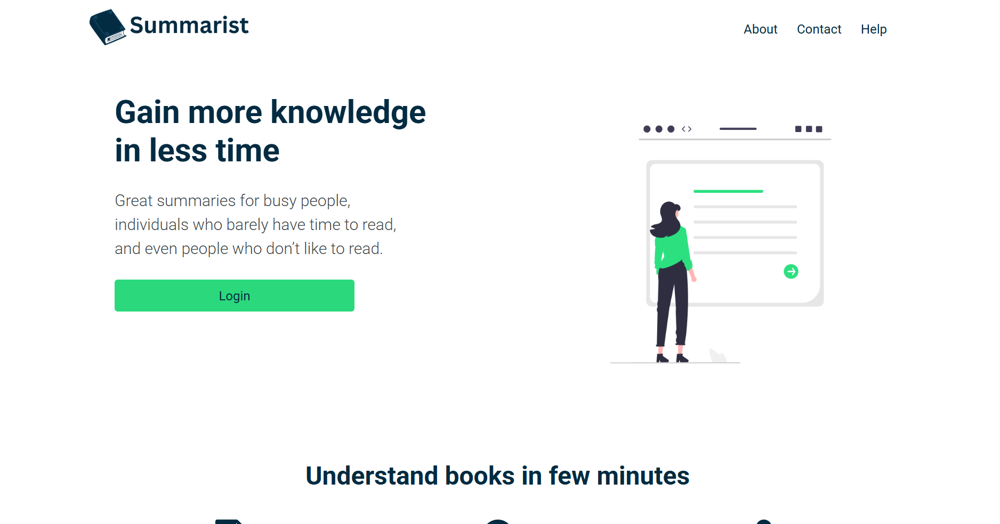

</> Markdown
## Summarist Book Summary Screenshot



## 🛠️ Tech Stack
* Next.js 16: App Router, server components
* React 19: UI components and hooks
* TypeScript: type-safe frontend and backend code
* Redux Toolkit: shopping cart state management
* Stripe: secure card payments and billing
* Firebase Authentication: customer and admin sign-in
* Cloud Firestore: orders and inventory database
* Firebase Admin SDK: server-side token verification
* Nodemailer: automated purchase email notifications
* CSS: custom responsive styling
* Vitest: fast unit and component testing
* React Testing Library: user-focused component behavior tests
* jsdom: simulated browser for running tests
* ESLint: code quality and consistency checks
* Vercel: hosting with automatic GitHub deploys

### 🚀 Key Features

* 📚 Book discovery: browse selected, recommended and suggested books
* 🔍 Live search: find books by title or author
* 🎧 Read or listen: text summaries and an audio player
* ⭐ Ratings and prices: star ratings and a price on every book
* 🛒 Shopping cart: saved cart, quantity controls, continue-shopping option
* 💳 Stripe checkout: secure card payment with billing address
* 📧 Purchase emails: branded receipts to buyers, alerts to the business
* 🔐 Firebase sign-in: customer accounts with login and sign-up
* 🛡️ Admin portal: login for approved, email-verified admins only
* 📊 Sales dashboard: revenue totals, daily sales chart, transaction history
* 📦 Inventory management: stock editing and low-stock alerts
* 🗑️ Transaction control: delete orders and optionally restock items
* ⚡ Performance: server rendering, caching, optimized images, loading skeletons
* 📱 Responsive design: works on phones, tablets and desktops
* 🚀 Continuous deployment: Vercel redeploys automatically on every GitHub push
* 🧪 Automated testing: 33 Vitest and React Testing Library tests

## Summarist Book Summary Platform

🔗 **Live Demo:** [View Live Website](https://summarist-app-purple-gold.vercel.app/)

A React platform that helps readers discover popular books

## Summarist Book Summary Run Instructions

## 🚀 Getting Started

## Local Development Setup Guide

### 1. Prerequisites

Before setting up the project, ensure the following software is installed on your Windows computer.

| Software | Requirement | Purpose |
|---|---|---|
| Node.js | Version 20.9 or higher | JavaScript runtime |
| npm | Included with Node.js | Package management |
| Visual Studio Code | Latest version recommended | Code editor |
| Git | Latest version recommended | Version control |
| Google Chrome | Latest version recommended | Browser testing |

#### Step 1: Install Node.js

1. Visit the official Node.js website: https://nodejs.org/
2. Download and install the appropriate Node.js version.
3. Follow the installation instructions.
4. Ensure the option to add Node.js to your system PATH is enabled.

Open the VS Code integrated terminal:

**Terminal → New Terminal**

Verify your installation:

```powershell
node -v
```

Expected output:

```text
v20.9.0
```

Check npm:

```powershell
npm -v
```

You should see an installed npm version.

#### Step 2: Install Git

Download Git from:

https://git-scm.com/downloads

Verify installation:

```powershell
git --version
```

---

### 2. Clone or Open the Project

If you are cloning the project from GitHub, open your VS Code terminal and execute:

```powershell
git clone YOUR_GITHUB_REPOSITORY_URL
```

Navigate into the project directory:

```powershell
cd YOUR_PROJECT_FOLDER
```

Alternatively, if you already have the project downloaded:

1. Open Visual Studio Code.
2. Select **File → Open Folder**.
3. Navigate to the Books E-commerce Website project folder.
4. Select the project folder and click Open.

Ensure that the root directory contains:

- `package.json`
- `package-lock.json`
- `next.config.ts`
- `tsconfig.json`
- `.env.example`

---

### 3. Install Project Dependencies

The project includes a `package.json` and `package-lock.json`, which manage the application's dependencies.

Since the project already contains a package-lock file, use `npm ci` to install the exact dependency versions recorded in the lockfile.

Run:

```powershell
npm ci
```

This command:

- Installs all required project dependencies.
- Uses the versions specified in `package-lock.json`.
- Ensures a consistent installation.
- Creates the `node_modules` directory.
- Helps prevent dependency-version inconsistencies.

**Important:** Do not delete `package-lock.json` before running this command.

If `npm ci` fails because the package files are out of sync, run:

```powershell
npm install
```

---

### 4. Configure Environment Variables

The project includes a `.env.example` file.

This file serves as a template for configuring environment variables required by external services.

#### Step 1: Create your environment file

From the project root directory, execute:

```powershell
Copy-Item .env.example .env.local
```

Next.js automatically loads environment variables from `.env.local` during development.

#### Step 2: Configure your API credentials

Open `.env.local` in VS Code.

Based on the project structure, the application uses or references the following integrations:

**Firebase**
- Firebase authentication.
- User login and registration.
- Administrative authentication.

**Stripe**
- Payment processing.
- Checkout and payment intents.
- Stripe webhook integration.

**Email Service**
- Payment confirmation emails.
- Order-related notifications.

The exact environment variable names and required values must be taken from your actual `.env.example` file and the corresponding configuration files.

To inspect the template in PowerShell:

```powershell
Get-Content .env.example
```

Check the following files for additional environment variable requirements:

```text
firebaseConfig.js
lib/stripe.ts
lib/email.ts
lib/admin-auth.ts
app/api/checkout/payment-intent/route.ts
app/api/checkout/payment-email/route.ts
app/api/webhooks/stripe/route.ts
```

Add the required credentials to `.env.local`.

**Important security considerations:**

- Never commit `.env.local` to GitHub.
- Never expose Stripe secret keys in frontend components.
- Never expose Firebase Admin credentials publicly.
- Only use the `NEXT_PUBLIC_` prefix for environment variables that are intentionally exposed to the browser.
- Use Stripe test credentials when testing payments locally.

---

### 5. Start the Development Server

Once dependencies and environment variables are configured, start the Next.js development server.

Execute:

```powershell
npm run dev
```

You should see output similar to:

```text
> next dev

▲ Next.js
- Local: http://localhost:3000

✓ Starting...
✓ Ready in 2.5s
```

Open your browser and navigate to:

**http://localhost:3000**

Your Books E-commerce Website should now be running locally.

The development server supports hot reloading, meaning changes made to your React components, CSS files, and other application files will automatically appear in the browser.

To stop the development server, press:

```text
CTRL + C
```

---

### 6. Run the Application in Production Mode

To verify that the application can successfully build for production, execute:

```powershell
npm run build
```

This generates an optimized production build.

After a successful build, start the production server:

```powershell
npm run start
```

Open:

http://localhost:3000

To stop the production server:

```text
CTRL + C
```

---

### 7. Run the Automated Tests

The project includes a test suite under the `__tests__` directory and a `vitest.config.mts` configuration file.

This indicates that the project uses Vitest for automated testing.

Run the tests using:

```powershell
npx vitest run
```

To run tests in watch mode:

```powershell
npx vitest
```

The tests cover several application components and functionalities, including:

- Authentication error handling.
- Authentication modal.
- Book cards.
- Shopping cart functionality.
- Book catalog.
- Footer component.
- Star ratings.
- Stripe checkout items.

---

### 8. Run ESLint

The project includes an ESLint configuration file:

```text
eslint.config.mjs
```

To run ESLint, execute:

```powershell
npx eslint .
```

This checks the project for potential JavaScript and TypeScript errors, coding issues, and linting violations.

---

### 9. Launch and Debug Using VS Code

The supplied project structure does not currently show a `.vscode` directory or `launch.json` file.

However, you can create your own VS Code debugging configuration.

#### Step 1: Create the VS Code configuration folder

In your project's root directory, create:

```text
.vscode
```

Inside that folder, create:

```text
launch.json
```

Your project structure should now include:

```text
.vscode/
    launch.json
```

#### Step 2: Add the debugging configuration

Paste the following configuration into `.vscode/launch.json`:

```json
{
  "version": "0.2.0",
  "configurations": [
    {
      "name": "Next.js: Debug Development Server",
      "type": "node",
      "request": "launch",
      "runtimeExecutable": "npm",
      "runtimeArgs": [
        "run",
        "dev"
      ],
      "console": "integratedTerminal",
      "serverReadyAction": {
        "action": "debugWithChrome",
        "pattern": "Local:\\s+(https?://localhost:\\d+)",
        "uriFormat": "%s",
        "webRoot": "${workspaceFolder}"
      }
    }
  ]
}
```

This configuration launches the Next.js development server and automatically opens Chrome with debugging enabled once the server is ready.

#### Step 3: Start debugging

1. Open the project in VS Code.
2. Click the **Run and Debug** icon on the left sidebar.
3. Select `Next.js: Debug Development Server`.
4. Click the green Start Debugging button.
5. Wait for Next.js to start.
6. Chrome should automatically open your application.

You can now:

- Set breakpoints in your application.
- Inspect variables.
- Step through JavaScript execution.
- Debug frontend functionality.
- Investigate runtime errors.

**Note:** If VS Code does not recognize `debugWithChrome`, install the Microsoft JavaScript Debugger extension or use the built-in JavaScript Debugger available in current VS Code versions.

---

### 10. Troubleshooting Common Issues

| Problem | Recommended Solution |
|---|---|
| `npm is not recognized` | Reinstall Node.js and ensure it is added to PATH. |
| `Module not found` | Run `npm ci` again. |
| Port 3000 already in use | Stop the other process or run `npm run dev -- --port 3001`. |
| Firebase authentication errors | Verify Firebase credentials in `.env.local` and the Firebase configuration. |
| Stripe payment errors | Verify Stripe test keys and webhook configuration. |
| Environment variables undefined | Check variable names and restart the development server. |
| TypeScript compilation errors | Inspect the reported file and line number. |
| Images not displaying | Verify image paths and filenames in the `public` directory. |
| Tests failing | Run `npx vitest run` and inspect the error output. |

---

### 11. Quick Reference: Essential Commands

Use the following commands whenever you need to work on the project.

| Task | Command |
|---|---|
| Install dependencies | `npm ci` |
| Start development server | `npm run dev` |
| Build production application | `npm run build` |
| Start production server | `npm run start` |
| Run automated tests | `npx vitest run` |
| Run tests in watch mode | `npx vitest` |
| Run ESLint | `npx eslint .` |
| Check Node.js version | `node -v` |
| Check npm version | `npm -v` |

### 12. Final Verification Checklist

Before considering your local development environment ready, verify the following:

- [ ] Node.js 20.9 or higher is installed.
- [ ] Git is installed.
- [ ] The project is opened in VS Code.
- [ ] All dependencies have been installed successfully.
- [ ] `.env.local` has been created from `.env.example`.
- [ ] Firebase credentials are configured.
- [ ] Stripe test credentials are configured.
- [ ] Email service credentials are configured, if required.
- [ ] The Next.js development server starts successfully.
- [ ] The application loads at `http://localhost:3000`.
- [ ] Automated tests execute successfully.
- [ ] ESLint executes successfully.
- [ ] VS Code debugging configuration is working.

**The project is now ready for local development and testing.**
